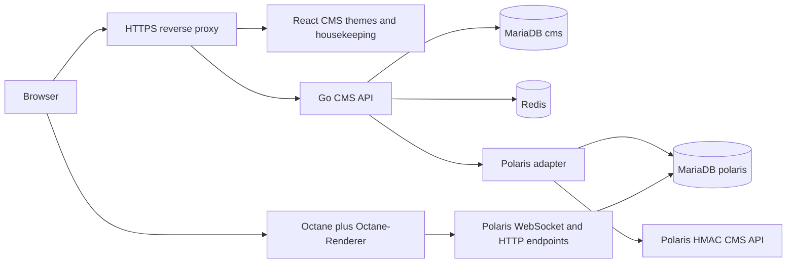

# PHPRetro port: implementation plan

Reviewed 2026-10-11. Target repository: `PapaBill1234/phpretro-port`, public. Final user database choice: **MariaDB**. No PostgreSQL is required.

## Product boundary

Rewrite PHPRetro's CMS backend in Go and its website/housekeeping in React and TypeScript. Integrate the existing Polaris game server and Octane browser game client. Retain the original website's features through a legacy theme; add a second theme matching the current Habbo public-site layout and interactions with original artwork. Housekeeping controls installed themes, default/enabled languages, translated content and site configuration.

The initial reference snapshots are PHPRetro `8ab8f81e`, Polaris `0101ce95`, Octane `67ec3ce1`, ts-rust `d8fe7823`, and the previous preservation attempt `af26734c`. Full immutable references appear in the source contracts. Refresh references deliberately, with contract tests, rather than chasing moving branches.

"100%" means every agreed route, interaction and visible state in a pinned acceptance catalogue has evidence. It does not mean an unmeasured claim about all Habbo systems. Reference layout can be faithfully reconstructed; original artwork will intentionally have different pixels. Freeze geometry, spacing, breakpoints, typography metrics, interaction states and content slots, and review original art separately. An authenticated Habbo reference session was not supplied; those views remain explicit gaps.

## Stack and data ownership



Begin with a modular Go monolith and a background job runner. Reuse the verified pure account/profile projections and frontend validators/localization helpers from the previous attempt. Its HTTP server hardcodes an authenticated demo user, has no real database/cache adapter, and its frontend is a fixture shell without implemented themes. These portions cannot be promoted into production. The previous Polaris adapter also scans an integer creation timestamp into `time.Time`, masked by its mock; rebuild that boundary with a real schema fixture. See [backend reuse](backend-reuse.md) and [frontend reuse](frontend-reuse.md).

Use the standard Go HTTP stack, explicit interfaces for repositories, parameterized SQL, versioned migrations, and structured logs. Select and pin supported dependencies in Phase 1 after checking their official releases. Frontend packages use lockfiles and reproducible builds.

| Owner | Data | Rules |
|---|---|---|
| Go CMS, `cms` database | website sessions, staff permissions/MFA, news/content, locales, themes, audit trail, migration mapping, jobs/outbox | Own migrations and a separate DB principal. No theme-specific business tables. |
| Polaris, `polaris` database | game identity, `users.username`, bcrypt password, game tickets, rooms, inventory, wallet, friends/groups and emulator state | Respect the actual schema and supported command interfaces. Never run the old installer against it. |
| Redis | bounded cache entries, invalidation revisions, distributed rate-limit state | Cache failure degrades ordinary reads to MariaDB; authentication/rate-limit behavior has explicit conservative fallback. Redis is not sole authority for money or permissions. |
| Versioned asset catalogue | original art, approved fonts/audio and game bundles | Record author, source/license, checksum and scope. Do not import upstream art merely because code is GPL. |

Use immutable Polaris user IDs, linked by an explicit CMS mapping. Do not merge on a display name or email. New game passwords must remain bcrypt-compatible with Polaris; do not silently replace them with an incompatible hash. Staff-only secrets may use a separate modern format. Treat MariaDB username collation and the 25-character game limit as part of the registration contract.

Separate databases can live on one MariaDB instance initially. Services use separate least-privilege principals. Cross-service work has idempotency keys, outbox/reconciliation and clear ownership; do not pretend one transaction spans HTTP commands, Redis and database updates.

## Repository layout when application work starts

```text
cmd/cms/                    Go API entry point
cmd/jobs/                   bounded background jobs
internal/auth/              website sessions, login, staff security
internal/content/           news, support and CMS domains
internal/housekeeping/      authorization and audited staff operations
internal/i18n/              catalogues, locale policy, content fallback
internal/themes/            installed manifests and validated settings
internal/polaris/           identity, read models, tickets, HMAC commands
internal/storage/           MariaDB repositories and Redis clients
api/openapi.yaml            versioned API/DTO contract
migrations/cms/             CMS-owned migrations only
apps/web/                   shared router, state and housekeeping
packages/theme-api/         DTOs, slots and capability interfaces
packages/theme-legacy/      recreated PHPRetro layout
packages/theme-modern/      recreated current public-site layout
packages/widgets/           avatar/badge/audio/browser replacements
integrations/octane/        pinned build/integration metadata and patches
tests/contracts/            Polaris/schema/client tests
tests/parity/               route, interaction and visual catalogue
docs/                       plans, decisions, gaps and evidence index
```

Application directories are a design proposal; the planning package does not fill them with empty scaffolds or claim that they are implemented.

## Implementation phases and exit criteria

### Phase 0 — evidence and builder readiness

Freeze upstream SHAs, inventory routes/widgets/assets, define API/data ownership, establish the public GitHub repository, write compact skills, and verify provider tooling. Obtain model IDs from the actual provider catalogue and probe Messages/tool behavior before using a6api with Claude Code. Preserve unrelated existing projects and global settings. Cost reporting begins with the first external request.

Exit: source contracts reviewed, no secrets/assets in Git, task/commit policy fixed, model transport status reported truthfully, and the ranked gaps ledger can drive task selection. This phase is the purpose of the initial planning delivery.

### Phase 1 — buildable foundation

Extend the imported Go domain packages and frontend contract library into a buildable Go/React application with pinned toolchains and lockfiles, MariaDB/Redis development containers on private networks, migrations, health endpoints, OpenAPI DTO generation, CI and a fake emulator adapter for isolated tests. Port coherent components incrementally; do not copy the previous demo entry points or operations stack. Bring in Octane/Renderer only after licensing/provenance and version checks. Configure compiler checks with ts-rust and a same-upstream-version TypeScript oracle; keep a documented fallback until JSX, generated DTOs and package references pass.

Exit: clean checkout builds reproducibly; real MariaDB migrations apply twice safely; Redis loss is exercised; no production connection is needed. CI reports compiler divergence explicitly instead of silently accepting whichever compiler passes.

### Phase 2 — first secure vertical slice

Implement registration/login/logout, website sessions, an account summary, staff bootstrap/MFA, one audited admin action, game-ticket launch and Octane/Polaris connection. Website login authenticates the canonical Polaris game account through the Go adapter; direct game-client auth remains separately constrained. Protect CMS sessions with HttpOnly Secure SameSite cookies, CSRF checks and revocation. Keep SSO and HTTP/client tokens separate.

**Important upstream blocker:** Polaris's inspected game ticket consumer ignores its expiry column and clears by user ID. A Go-only TTL does not fix that. Add a maintained Polaris compatibility patch or verified equivalent enforcement covering expiry and conditional single-use consumption; prove concurrent issuance, replay and reconnect behavior. `debug_sso` must be off. Do not claim secure launch until the emulator boundary passes.

Exit: actual clean Polaris instance + Octane can launch a fixture user; expired/replayed tickets fail, concurrent ticket issuance is safe, reconnect works, staff checks fail closed, and logs/URLs do not disclose launch credentials. No mock-only completion.

### Phase 3 — theme ABI and localization

Implement a shared route/DTO/capability system, theme manifests, built-in fallback components and two independent theme packages. Implement housekeeping theme preview/activation with an audited revision and rollback. Ship English as the complete source catalogue and Dutch as the first additional catalogue, chosen as an initial default test language rather than an inferred user preference. Add a pseudo-locale and RTL fixture to test expansion/direction. Additional real translations enter via the same catalogue process.

Housekeeping sets enabled/default locales and content translations. Persist account locale; precedence is explicit user setting, account preference, supported browser language, site default, then English. Translation keys/ICU placeholders are validated; API errors use stable codes; locale changes invalidate versioned caches. Separate CMS language from Octane's `base.locale` and its own catalogue coverage.

Exit: both themes render the same feature fixtures and switch without backend changes. Missing optional modules fall back. Locale changes are audited and visible; strings expand, pluralize and render RTL without breaking navigation. Newly ported themes add no schema or auth logic.

### Phase 4 — website parity and CMS Flash replacements

Build the modern public-site pages and legacy pages against pinned reference states. On the public Habbo homepage inspected on 2026-10-11, the reference includes login/registration, primary navigation, product cards, news, safety/parent links and footer. Recreate structure and original visual art; do not import production HTML/CSS/images/fonts or claim third-party OAuth buttons work unless those providers are configured.

Replace CMS avatar/registration, badge composer, Trax audio and promotional animations with React, canvas/SVG, Web Audio and CSS as appropriate. There is no ActionScript source in the PHPRetro snapshot. Implement behavior from caller contracts; ts-rust cannot convert SWF. Add Rust/WASM only after profiling identifies a real need. See the Flash plan for each file and asset dependency.

Exit: named page/widget fixtures and keyboard/accessibility flows pass. Visual reports compare geometry with approved references and original art with approved art; no arbitrary screenshot percentage is presented as total parity.

### Phase 5 — complete functional port

Deliver news/archive/RSS, profiles/friends, homes/widgets/guestbooks, groups/forums, minimail, support/FAQ, club/vouchers/credits and the corresponding housekeeping modules as separate vertical slices. Keep monetization behind an explicit configured provider; no accidental live charging. Model unsupported Polaris features as capability gaps, not empty successful endpoints. Legacy events are not a working baseline in the audited adapter.

Exit: every inventory item is implemented, deliberately replaced, or listed as an open gap with evidence. Each slice has authorization checks, real database coverage and route-level acceptance fixtures in both themes.

### Phase 6 — data migration, hardening and release

Build a read-only inventory/dry-run importer before writes. Export legacy data offline; map identities and resolve username/collation collisions explicitly. Migrate content separately from game state; Holograph rooms/items/wallets are not automatically Polaris-compatible. Legacy SHA-1 hashes cannot be inverted into bcrypt: prefer reset, or a time-limited isolated verifier that upgrades only after a successful login. Rehearse on disposable copies with counts, mapping reports, rollback and backup restore.

Exercise threat-model checks, dependency/secret scans, fuzz targets, concurrency tests, performance budgets, actual Octane integration, theme/locale matrix and accessibility. Release to staging first, with migration rehearsals and observable rollback. Production deployment is a later concrete action; this planning delivery changes no production database.

Exit: all release-blocking gaps have independent evidence, restore rehearsal passes, assets have approved provenance, and the accepted route/state catalogue passes on a fresh deployment. An agent cannot promise zero vulnerabilities; completion means the specified controls and tests have evidence, with remaining risk recorded.

## Autonomous builder process

Use DeepSeek 4.1 Flash as the cost-conscious lead if tool compatibility passes; Luna handles two or three independent bounded discovery/implementation tasks; Sol 6.1 handles architecture, auth/schema decisions and integration review. Jev narrows evidence candidates and triages typed findings. Model names are provider IDs verified at setup, not assumed API capabilities.

Workers own separate worktrees and commit after their checks. The integrator verifies contracts, reviews evidence and runs required checks on the combined diff before updating main. An auth/schema migration always invokes Sol. Two identical failures trigger root-cause review; do not let a cheap swarm iterate indefinitely. Resume from durable task state after a CLI exits.

Use priority order in `docs/gaps.md`, then dependencies, then atomic claims. Work can continue while a missing external reference is parked: complete independent API, security and fixture work rather than fabricating evidence. Detailed budgets, telemetry and review rules are in `docs/builder-operations.md`.

No calendar promise is made before Phase 2 produces measured accepted-task throughput. Re-estimate effort from completed units; parallel agents do not eliminate integration, original-art or emulator compatibility work.
